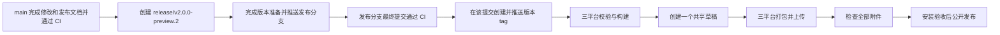

# 发布指南

Pointer 采用 `main` 日常开发和维护发布文档、`release/v<完整版本号>` 隔离单个版本发布、Git tag 固定发布提交、CI 上传 GitHub Release 草稿、安装验收后公开发布的流程。先在 `main` 完成文档修正并通过 CI，再创建对应版本的发布分支；发布分支的最终提交通过 CI 后，才能在该提交上创建同版本 tag。

本文中的 `release/v2.0.0-preview.2` 和 `2.0.0-preview.2` 是示例。操作时使用本次尚未发布的完整版本号，包括预发布标识。工作流会校验版本与 tag，固定源码提交并复用各平台校验和构建后的产物，其中 Windows 额外经过真实桌面端到端测试。

## 分支、tag 与 Release

| 对象           | 用途                                           | 示例                       |
| -------------- | ---------------------------------------------- | -------------------------- |
| `main`         | 集成日常开发，通过 PR 和 CI 校验               | 新功能与修复的主线         |
| release 分支   | 隔离一个完整版本的发布准备与验收               | `release/v2.0.0-preview.2` |
| Git tag        | 标记该版本所对应的确定提交，发布后保持不变     | `v2.0.0-preview.2`         |
| GitHub Release | 关联 tag，提供更新说明、安装包和自动更新元数据 | Pointer 2.0.0-preview.2    |

每个版本使用独立发布分支。例如 `2.0.0-preview.2`、`2.0.0` 和 `2.0.1` 分别使用 `release/v2.0.0-preview.2`、`release/v2.0.0` 和 `release/v2.0.1`。tag 在 Git 中标记的是提交；本项目要求它指向对应发布分支上通过 CI 的最终提交，不直接从 `main` 打 tag。发布分支后续变化不会改变已有 tag，删除维护结束的分支也不会删除 tag。



## 版本约定

- `package.json.version` 不带 `v`，对应 tag 必须为 `v` 加上完整版本号，例如 `2.0.0-preview.2` 对应 `v2.0.0-preview.2`。
- 发布分支名为 `release/` 加上对应 tag，例如 `release/v2.0.0-preview.2`；一个完整版本对应一个发布分支和一个 tag。
- 预发布可依次使用 `2.0.0-preview.1`、`2.0.0-preview.2`、`2.0.0-rc.1`，稳定后发布 `2.0.0`。
- 正式版的兼容性修复增加补丁号，例如 `2.0.1`；兼容的新功能增加次版本号，例如 `2.1.0`；不兼容的变更增加主版本号，并在说明中明确迁移影响。
- 预发布转正式版时，要创建正式版本对应的发布分支，提交正式版本号并创建新 tag，重新构建对应安装包。仅修改 GitHub Release 标题不会改变安装包内的版本号。
- 已公开的版本不覆盖产物、不移动 tag。代码变化使用新版本发布。

版本含义及已发布版本不可修改的约定见 [SemVer](https://semver.org/lang/zh-CN/)。

## 发布操作

### 1. 在 main 完成文档修正，再建立发布分支

将本次要发布的功能、修复以及发布文档的修正先提交并推送到 `main`。确认工作区干净、远端对应提交的 CI 已通过，再从该确定提交创建发布分支：

```bash
git switch main
git pull --ff-only origin main
git show -s --format="%H %s" HEAD
# 确认以上 SHA 对应已通过的 main CI 后，再创建分支。
git switch -c release/v2.0.0-preview.2
```

如果拉取后 `main` 的 HEAD 已变化，需要先等待新提交的 CI 通过。若 `release/v2.0.0-preview.2` 已存在，只能在确认它属于本次版本、且尚未打 tag 时切换并同步，继续未完成的发布准备；不能覆盖或重置已有发布分支。建立分支后，`main` 可以继续开发下一版本。

### 2. 提交版本号和发布准备

在发布分支核对 `package.json` 的 `version`，不一致时改为本次版本，例如：

```json
"version": "2.0.0-preview.2"
```

版本号有变化时提交；若已是目标版本且没有其他准备变更，跳过提交，不创建空提交。随后推送发布分支：

```bash
git add package.json
git commit -m "chore(release): prepare 2.0.0-preview.2"
git push -u origin release/v2.0.0-preview.2
```

有依赖或相关文档变更时，将对应锁文件和文档一并提交。整理本次新功能、修复、兼容性变化及已知限制，供 Release 说明使用。

### 3. 校验待发布的提交

发布前需要通过 [测试指南](testing.md) 中的完整校验。远端执行情况以 GitHub Actions 为准：

- Windows：lint、类型检查、发布脚本回归、覆盖率门槛、压力测试、内核 smoke、生产构建和 Electron 桌面测试；构建包括体积预算检查。
- Linux/macOS：发布脚本回归、快速测试和压力测试；发布工作流调用时还执行类型检查、生产构建及体积预算检查。

`ci.yml` 自动校验 PR、`main` 和 `release/**` 分支推送。需要手动重跑时，进入 Actions → Validate → Run workflow，选择本次发布分支。等待该发布分支的校验全部通过；打 tag 前确认成功运行对应的分支和提交 SHA 都与本次发布目标一致。

记录通过校验的提交 SHA。校验后又修改了代码、版本号或构建配置时，需要重新校验新的提交。

### 4. 在发布分支通过校验的提交上创建 tag

同步本次发布分支，确认本地 HEAD、远端发布分支与上一步通过 CI 的提交 SHA 一致，且版本号正确：

```bash
git switch release/v2.0.0-preview.2
git pull --ff-only origin release/v2.0.0-preview.2
git status --short
git branch --show-current
git show -s --format="%H %s" HEAD
git rev-parse origin/release/v2.0.0-preview.2
node -p "'v' + require('./package.json').version"
```

预期工作区无待提交修改，当前分支为 `release/v2.0.0-preview.2`，版本命令输出 `v2.0.0-preview.2`。如果提交已变化，先重新校验。确认本地和远端都没有使用该 tag 后，明确以本次发布分支为目标创建附注 tag，通过发布校验后单独推送：

```bash
git tag -a v2.0.0-preview.2 release/v2.0.0-preview.2 -m "Pointer 2.0.0-preview.2"
pnpm check:release
git push origin v2.0.0-preview.2
```

最后一条命令会触发发布工作流。普通分支推送默认不推送 tag；这里显式推送单个 tag，避免同时发布其他本地 tag。Git tag 的创建和推送方式见 [Git 官方文档](https://git-scm.com/book/en/v2/Git-Basics-Tagging)。

### 5. 等待 CI 打包并上传草稿

当前 [release.yml](../.github/workflows/release.yml) 监听 `v*` tag 推送，按以下顺序执行：

1. `prepare` 解析已存在的 tag，校验该提交中的 `package.json.version` 与 tag 一致，并输出固定的提交 SHA。tag 推送事件还会核对该 SHA 与触发事件一致。
2. `validate` 把该 SHA 传给复用的 [ci.yml](../.github/workflows/ci.yml)，所有平台检出同一份源码。Windows 桌面测试通过后上传 `release-build-windows`；Linux/macOS 完成测试与构建后分别上传 `release-build-linux` 和 `release-build-macos`。每份 artifact 都包含本平台的 `out/main`、`out/preload` 和 `out/renderer`。
3. `draft` 等待全部校验通过，只创建或更新一次共享草稿，输出其 ID，并按版本设置 Pre-release 标记。已公开的版本拒绝覆盖。
4. `publish` 矩阵在各自系统中检出同一 SHA、安装冻结依赖、下载本平台构建产物，检查体积预算后直接打包，不重复编译。上传前再次核对 tag、SHA、干净工作区、远端 tag 与共享草稿 ID/类型，然后使用工作流提供的 `GITHUB_TOKEN` 上传。
5. `verify-assets` 等待三个打包任务全部成功，读取同一草稿 ID 的附件，确认 11 项核心产物均已上传且非零字节，并在 Actions Summary 提供草稿链接。不会自动公开 Release。

同一 tag 的工作流串行执行；一次工作流内部的三平台打包并行执行，某个平台失败不会取消其他平台。校验 job 使用只读权限，只有访问草稿与上传产物的 jobs 使用 `contents: write`。

`electron-builder.yml` 显式指定 `publish.releaseType: draft`，CI 上传步骤同时设置 `EP_DRAFT=true`。**上传完成不等于版本已公开。** 草稿发布选项见 [electron-builder 发布说明](https://www.electron.build/docs/publish/)。

### 平台与产物

| 平台    | CI 环境          | 架构       | 核心产物                                                                                     |
| ------- | ---------------- | ---------- | -------------------------------------------------------------------------------------------- |
| Windows | `windows-latest` | x64        | `pointer-<版本>-setup.exe`、对应 `.blockmap`、`latest.yml`                                   |
| macOS   | `macos-15`       | x64、arm64 | 每种架构的 `pointer-<版本>-mac-<架构>.dmg` 与 `.zip`，以及共享的 `latest-mac.yml`            |
| Linux   | `ubuntu-22.04`   | x64        | `pointer-<版本>-linux-x86_64.AppImage`、`pointer-<版本>-linux-amd64.deb`、`latest-linux.yml` |

macOS 的 Intel 与 Apple Silicon 安装包在同一个 electron-builder 调用中生成，文件名包含架构，更新元数据统一合并，避免独立 jobs 覆盖同名元数据。Linux 的 `x86_64` 与 `amd64` 是对应包格式对 x64 架构的命名。Linux job 安装 `libarchive-tools`、`libfuse2` 和 `libcrypt1`，当前只上传 AppImage/deb；Snap Store 不在本流程内。

macOS 目前提供**未签名、未公证的测试包**：`mac.identity: null`、`mac.notarize: false`，CI 关闭签名身份自动发现，无需 Apple 证书、账号或公证 Secrets。Gatekeeper 可能阻止安装或启动；这些包不支持 macOS 自动更新，需要手动下载安装后续测试版本。生成 ZIP 和更新元数据不代表自动更新已可用。

以后提供正式 macOS 分发包时，需接入 Developer ID 签名和 Apple 公证凭据，移除 `identity: null`、调整 CI 的身份发现设置并启用公证，再验证实际安装和更新。Windows/Linux 的发布类型不受 macOS 测试包性质改变；Release 说明中应明确注明 macOS 包的限制。

### 手动触发已有 tag

在 Actions → Build and Release → Run workflow 中，选择对应发布分支，例如 `release/v2.0.0-preview.2`，在必填的 `tag` 输入框填写已推送的同版本 tag，例如 `v2.0.0-preview.2`。工作流分支用于选择自动化定义，实际校验和打包的源码始终由输入的 tag 解析为固定 SHA。该入口用于重试已有 tag，不能代替先建立发布分支、通过 CI 再打 tag 的步骤。

分支名、提交 SHA、缺失的 tag、格式错误或版本不匹配的 tag 都会在准备阶段失败，不会进入上传步骤。目标 tag 必须包含当前发布脚本及 CI 所需的命令；更早的版本不会自动套用新脚本重新发布。

### 6. 验收并公开 Release

在 GitHub → Releases 打开对应草稿：

1. 核对 tag、版本号和发布提交，补充本次更新说明。
2. 确认三个平台的安装包、macOS 双架构、Windows `.blockmap` 及三个平台的更新元数据齐全，元数据引用的文件名和版本正确。以 `verify-assets` 成功为自动化附件检查依据。
3. 分别用本次产物验证安装与启动，并在测试账户或备份副本上验证数据保留及核心聊天流程。Windows/Linux 按实际安装格式验证升级；macOS 当前验证手动安装测试包，不能把它记为已通过签名和自动更新验收。
4. 核对 CI 自动设置的 **Pre-release** 标记：含预发布标识的版本为预发布，正式版本为普通 Release。本地直接上传的草稿需手动核对该标记。
5. 验收通过后点击 **Publish release**。公开后核对下载链接，并验证目标用户版本的更新检查能发现预期版本；预发布与正式版的更新行为需分别确认。

Draft 表示尚未公开，Pre-release 表示版本性质。GitHub 的草稿、预发布标记和发布操作见 [Release 管理说明](https://docs.github.com/en/repositories/releasing-projects-on-github/managing-releases-in-a-repository)。

### 7. 同步修复并维护后续版本

将 release 分支上的修复通过 PR 同步回 `main`，避免后续版本重新出现已修复的问题。同步时按主线实际开发进度处理版本号，不将 `main` 的版本号回退到旧系列。

后续版本创建各自的 `release/v<完整版本号>` 分支，不复用上一版本的发布分支。当前版本验收结束且修复已同步后，可以删除其发布分支，保留已发布的 tag 和 GitHub Release。

## 失败重试与紧急修复

- 安装依赖、网络或上传出现临时失败，源码与版本未变化时，可以重新运行同一 tag 的失败 jobs。已成功平台的附件保留，失败平台重传到同一草稿，最终检查三平台的完整附件。重跑草稿准备阶段也会保留已有标题与更新说明。
- `release-build-windows`、`release-build-macos`、`release-build-linux` 保留 7 天；产物过期后需重跑全部 jobs，重新校验和构建。某个平台失败时草稿可能只包含部分附件，需等全部打包任务和 `verify-assets` 成功后再公开。
- 打 tag 后如果必须修改源码、依赖或工作流，将修复同步到 `main` 并通过 CI，再创建新版本对应的发布分支，使用新版本、新 tag 重新发布；旧 tag 保留原提交。丢弃已被替代的未公开草稿，避免误发布。
- 正式版发生问题时，可从已发布 tag 建立修复分支定位并完成修复；将修复合入 `main` 并通过 CI 后，再创建新补丁版本的发布分支并重复上述流程。例如 `2.0.0` 的修复发布为 `2.0.1`，使用 `release/v2.0.1` 和 `v2.0.1`。
- 应用当前只接受更高版本作为更新。需要撤回某项变更时，将回退后的代码以更高版本发布，不依赖旧版本号自动降级。

## 当前命令的含义

| 命令或入口                                     | 当前行为                                                                                               |
| ---------------------------------------------- | ------------------------------------------------------------------------------------------------------ |
| 推送 `v*` tag                                  | 触发三平台校验、构建、打包与同一草稿上传，最后检查附件完整性                                           |
| Actions → Build and Release → Run workflow     | 必须填写已有版本 tag；解析固定 SHA 后走相同的校验、打包和草稿上传流程                                  |
| `pnpm check:release`                           | 校验当前版本 tag 存在、指向 HEAD、版本一致且工作区干净；CI 还核对预期 SHA                              |
| `pnpm release`                                 | 本地校验 tag、构建并上传 Windows 草稿，需要发布凭据；不单独执行完整 CI 测试或自动设置 Pre-release 标记 |
| `pnpm release:upload`                          | 校验 tag 后直接打包已有构建产物并上传 Windows 草稿；发布 CI 使用该命令避免重复编译                     |
| `pnpm release:upload:mac`                      | 在 macOS 上校验 tag 并打包已有产物，上传 x64/arm64 的未签名、未公证 DMG/ZIP 测试包                     |
| `pnpm release:upload:linux`                    | 在 Linux 上校验 tag 并打包已有产物，上传 x64 的 AppImage/deb                                           |
| `pnpm package:local`                           | 使用 `--publish=never`，构建并本地打包，不上传，也不创建 GitHub 草稿；替代原 `release:draft`           |
| `pnpm test:release`                            | 验证 tag、版本与提交约束、CLI 错误退出以及草稿创建、重试和公开版本保护                                 |
| `pnpm build:win` / `build:mac` / `build:linux` | 对应平台的构建打包入口，不能代替发布前的完整校验                                                       |

## 已实现的自动化保障

发布入口的实现集中在 [release.mjs](../scripts/release.mjs)，回归位于 [release.test.mjs](../scripts/release.test.mjs)。测试使用临时 Git 仓库及模拟的 GitHub API，不创建真实 Release。

| 项目             | 实现                                                                    |
| ---------------- | ----------------------------------------------------------------------- |
| 发布分支 CI      | `main`、`release/**` 推送及 PR 自动触发 CI                              |
| tag 与版本一致性 | 准备阶段及上传前检查 tag、版本、提交；打包工作区必须干净                |
| 手动发布入口     | 必填已有 tag，校验与发布 jobs 均检出解析后的固定 SHA                    |
| 草稿与发布类型   | 显式 Draft；CI 自动设置 Pre-release；验收后手动公开，已公开版本拒绝覆盖 |
| 重复构建         | 每个平台复用本平台已校验的构建产物，打包上传不再运行编译                |
| 共享草稿与多平台 | 只创建一次草稿；上传前核对相同 ID；三平台成功后检查 11 项核心附件       |
| 本地脚本命名     | `package:local` 明确只在本地打包；`release:upload` 明确使用已有产物     |

发布分支命名以及 tag 与对应分支提交的一致性由上述操作步骤核对。当前发布脚本校验版本、tag 和 SHA，尚未自动强制校验发布分支关系。
