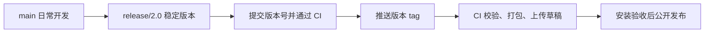

# 发布指南

Pointer 采用 `main` 日常开发、`release/<主版本.次版本>` 稳定版本、Git tag 确定发布提交、CI 上传 GitHub Release 草稿、安装验收后公开发布的流程。没有并行开发下一版本的需求时，可以直接从已通过校验的 `main` 提交打 tag。

本文中的 `release/2.0` 和 `2.0.0-preview.2` 是示例。操作时使用实际维护的版本系列和尚未发布的版本号。工作流会校验版本与 tag，固定源码提交并复用经过桌面测试的构建产物。

## 分支、tag 与 Release

| 对象           | 用途                                                   | 示例                    |
| -------------- | ------------------------------------------------------ | ----------------------- |
| `main`         | 集成日常开发，通过 PR 和 CI 校验                       | 新功能与修复的主线      |
| release 分支   | 稳定并维护一个版本系列，接收必要修复、版本号和文档更新 | `release/2.0`           |
| Git tag        | 标记该版本所对应的确定提交，发布后保持不变             | `v2.0.0-preview.2`      |
| GitHub Release | 关联 tag，提供更新说明、安装包和自动更新元数据         | Pointer 2.0.0-preview.2 |

同一条 `release/2.0` 可以发布多个预览版、正式版以及后续的 `2.0.x` 修复版，无需为每个 tag 建立分支。tag 标记的是提交，不隶属于某个分支；删除维护结束的分支不会删除 tag。



## 版本约定

- `package.json.version` 不带 `v`，对应 tag 必须为 `v` 加上完整版本号，例如 `2.0.0-preview.2` 对应 `v2.0.0-preview.2`。
- 预发布可依次使用 `2.0.0-preview.1`、`2.0.0-preview.2`、`2.0.0-rc.1`，稳定后发布 `2.0.0`。
- 正式版的兼容性修复增加补丁号，例如 `2.0.1`；兼容的新功能增加次版本号，例如 `2.1.0`；不兼容的变更增加主版本号，并在说明中明确迁移影响。
- 预发布转正式版时，要提交正式版本号并创建新 tag，重新构建对应安装包。仅修改 GitHub Release 标题不会改变安装包内的版本号。
- 已公开的版本不覆盖产物、不移动 tag。代码变化使用新版本发布。

版本含义及已发布版本不可修改的约定见 [SemVer](https://semver.org/lang/zh-CN/)。

## 发布操作

### 1. 从已校验的 main 建立稳定分支

将本次要发布的修改合入并推送到 `main`，确认工作区干净、远端对应提交的 CI 已通过，再执行：

```bash
git switch main
git pull --ff-only origin main
git switch -c release/2.0
```

如果 `release/2.0` 已存在，切换并同步现有分支，继续维护该系列。建立分支后，`main` 可以继续开发下一版本；发布分支主要处理本次验收发现的问题。

### 2. 提交版本号和发布准备

手动将 `package.json` 的 `version` 改为本次版本，例如：

```json
"version": "2.0.0-preview.2"
```

提交并推送：

```bash
git add package.json
git commit -m "chore(release): prepare 2.0.0-preview.2"
git push -u origin release/2.0
```

有依赖或相关文档变更时，将对应锁文件和文档一并提交。整理本次新功能、修复、兼容性变化及已知限制，供 Release 说明使用。

### 3. 校验待发布的提交

发布前需要通过 [测试指南](testing.md) 中的完整校验。远端执行情况以 GitHub Actions 为准：

- Windows：lint、类型检查、发布脚本回归、覆盖率门槛、压力测试、内核 smoke、生产构建和 Electron 桌面测试；构建包括体积预算检查。
- Linux/macOS：发布脚本回归、快速测试和压力测试。

`ci.yml` 自动校验 PR、`main` 和 `release/**` 分支推送。需要手动重跑时，进入 Actions → Validate → Run workflow，选择目标分支。打 tag 前确认校验对应的提交与待发布提交一致。

记录通过校验的提交 SHA。校验后又修改了代码、版本号或构建配置时，需要重新校验新的提交。

### 4. 在通过校验的提交上创建 tag

确认当前分支的 HEAD 就是上一步通过校验的提交，且版本号正确：

```bash
git status --short
git show -s --format="%H %s" HEAD
node -p "'v' + require('./package.json').version"
```

预期工作区无待提交修改，版本命令输出 `v2.0.0-preview.2`。确认该 tag 未被使用后，创建附注 tag 并单独推送：

```bash
git tag -a v2.0.0-preview.2 -m "Pointer 2.0.0-preview.2"
git push origin v2.0.0-preview.2
```

最后一条命令会触发发布工作流。普通分支推送默认不推送 tag；这里显式推送单个 tag，避免同时发布其他本地 tag。Git tag 的创建和推送方式见 [Git 官方文档](https://git-scm.com/book/en/v2/Git-Basics-Tagging)。

### 5. 等待 CI 打包并上传草稿

当前 [release.yml](../.github/workflows/release.yml) 监听 `v*` tag 推送，按以下顺序执行：

1. `prepare` 解析已存在的 tag，校验该提交中的 `package.json.version` 与 tag 一致，并输出固定的提交 SHA。tag 推送事件还会核对该 SHA 与触发事件一致。
2. `validate` 把该 SHA 传给复用的 [ci.yml](../.github/workflows/ci.yml)，所有平台检出同一份源码。Windows 桌面测试通过后，将 `out/main`、`out/preload` 和 `out/renderer` 保存为 `release-build` artifact。
3. `publish` 等待全部校验通过，检出同一 SHA、安装冻结锁文件中的依赖，下载已经通过测试的构建产物并检查体积预算，直接打包而不重新编译。
4. 上传前再次检查版本、tag、SHA 和工作区，并向 GitHub 核对远端 tag 未被移动。创建或更新草稿时根据版本号设置 Pre-release 标记；已公开的版本会拒绝覆盖。
5. 使用工作流提供的 `GITHUB_TOKEN` 上传 Windows 产物。只有发布 job 拥有 `contents: write` 权限；同一 tag 的发布任务串行执行。

`electron-builder.yml` 显式指定 `publish.releaseType: draft`，CI 上传步骤同时设置 `EP_DRAFT=true`。**上传完成不等于版本已公开。** 草稿发布选项见 [electron-builder 发布说明](https://www.electron.build/docs/publish/)。

自动发布目前只产出 Windows 安装包。Linux/macOS 的 CI 校验通过不代表已经生成这两个平台的安装包。

### 手动触发已有 tag

在 Actions → Build and Release → Run workflow 中，选择包含本发布工作流的分支（通常是 `main`），在必填的 `tag` 输入框填写已推送的版本 tag，例如 `v2.0.0-preview.2`。工作流分支用于选择自动化定义，实际校验和打包的源码始终由输入的 tag 解析为固定 SHA。

分支名、提交 SHA、缺失的 tag、格式错误或版本不匹配的 tag 都会在准备阶段失败，不会进入上传步骤。目标 tag 必须包含当前发布脚本及 CI 所需的命令；更早的版本不会自动套用新脚本重新发布。

### 6. 验收并公开 Release

在 GitHub → Releases 打开对应草稿：

1. 核对 tag、版本号和发布提交，补充本次更新说明。
2. 确认 `pointer-<版本>-setup.exe`、对应 `.blockmap` 及更新元数据（如 `latest.yml`）上传完整，元数据引用的文件名和版本正确。
3. 用本次产物验证安装与启动，并在测试账户或备份副本上验证旧版本升级、数据保留及核心聊天流程。
4. 核对 CI 自动设置的 **Pre-release** 标记：含预发布标识的版本为预发布，正式版本为普通 Release。本地直接上传的草稿需手动核对该标记。
5. 验收通过后点击 **Publish release**。公开后核对下载链接，并验证目标用户版本的更新检查能发现预期版本；预发布与正式版的更新行为需分别确认。

Draft 表示尚未公开，Pre-release 表示版本性质。GitHub 的草稿、预发布标记和发布操作见 [Release 管理说明](https://docs.github.com/en/repositories/releasing-projects-on-github/managing-releases-in-a-repository)。

Windows 签名配置见 [代码签名指南](code-signing-guide.md)。当前构建配置中 `win.verifyUpdateCodeSignature` 为 `false`，发布工作流尚未配置签名证书；签名与升级验收需按实际发布要求安排。

### 7. 同步修复并维护后续版本

将 release 分支上的修复通过 PR 同步回 `main`，避免后续版本重新出现已修复的问题。同步时按主线实际开发进度处理版本号，不将 `main` 的版本号回退到旧系列。

需要继续维护 `2.0.x` 时保留 `release/2.0`。维护结束且修复已同步后，可以删除分支，保留已发布的 tag 和 GitHub Release。

## 失败重试与紧急修复

- 安装依赖、网络或上传出现临时失败，源码与版本未变化时，可以重新运行同一 tag 的失败工作流。重跑会保留已有草稿的标题与更新说明，校正发布类型，再上传产物。`release-build` 保留 7 天；产物过期后需重跑全部 jobs，重新校验和构建。确认草稿产物完整后再公开。
- 如果必须修改源码、依赖或工作流，提交修复并使用新版本、新 tag 再发布；旧 tag 保留原提交。丢弃已被替代的未公开草稿，避免误发布。
- 正式版发生问题时，从对应维护分支或已发布 tag 建立修复分支，完成修复及回归，更新补丁版本并重复上述流程。例如 `2.0.0` 的修复发布为 `2.0.1`，同时把修复同步回 `main`。
- 应用当前只接受更高版本作为更新。需要撤回某项变更时，将回退后的代码以更高版本发布，不依赖旧版本号自动降级。

## 当前命令的含义

| 命令或入口                                     | 当前行为                                                                                               |
| ---------------------------------------------- | ------------------------------------------------------------------------------------------------------ |
| 推送 `v*` tag                                  | 触发完整校验，通过后执行 Windows 打包上传                                                              |
| Actions → Build and Release → Run workflow     | 必须填写已有版本 tag；解析固定 SHA 后走相同的校验、打包和草稿上传流程                                  |
| `pnpm check:release`                           | 校验当前版本 tag 存在、指向 HEAD、版本一致且工作区干净；CI 还核对预期 SHA                              |
| `pnpm release`                                 | 本地校验 tag、构建并上传 Windows 草稿，需要发布凭据；不单独执行完整 CI 测试或自动设置 Pre-release 标记 |
| `pnpm release:upload`                          | 校验 tag 后直接打包已有构建产物并上传 Windows 草稿；发布 CI 使用该命令避免重复编译                     |
| `pnpm package:local`                           | 使用 `--publish=never`，构建并本地打包，不上传，也不创建 GitHub 草稿；替代原 `release:draft`           |
| `pnpm test:release`                            | 验证 tag、版本与提交约束、CLI 错误退出以及草稿创建、重试和公开版本保护                                 |
| `pnpm build:win` / `build:mac` / `build:linux` | 对应平台的构建打包入口，不能代替发布前的完整校验                                                       |

## 已实现的自动化保障

发布入口的实现集中在 [release.mjs](../scripts/release.mjs)，回归位于 [release.test.mjs](../scripts/release.test.mjs)。测试使用临时 Git 仓库及模拟的 GitHub API，不创建真实 Release。

| 项目             | 实现                                                                    |
| ---------------- | ----------------------------------------------------------------------- |
| release 分支校验 | `main`、`release/**` 推送及 PR 自动触发 CI                              |
| tag 与版本一致性 | 准备阶段及上传前检查 tag、版本、提交；打包工作区必须干净                |
| 手动发布入口     | 必填已有 tag，校验与发布 jobs 均检出解析后的固定 SHA                    |
| 草稿与发布类型   | 显式 Draft；CI 自动设置 Pre-release；验收后手动公开，已公开版本拒绝覆盖 |
| 重复构建         | 通过 artifact 复用 Windows 桌面测试通过的产物，打包上传不再运行编译     |
| 本地脚本命名     | `package:local` 明确只在本地打包；`release:upload` 明确使用已有产物     |
